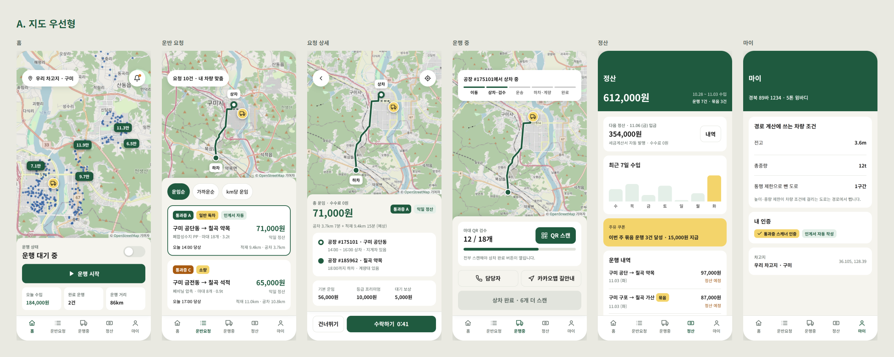
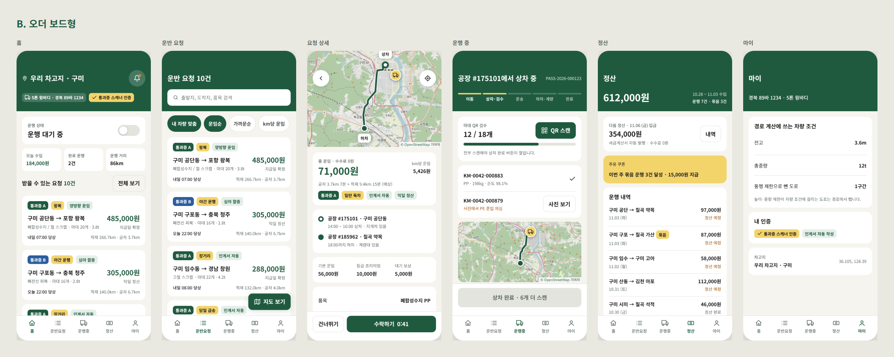
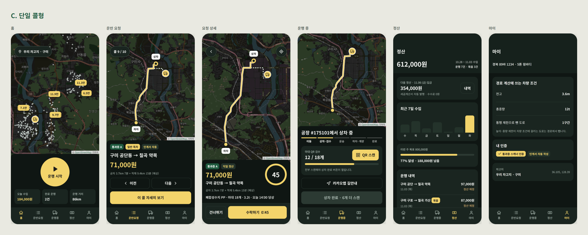

# 운송 파트너 앱 콜 화면 시안 (A·B·C안, 구미 산업단지 기준)

화물차 기사가 폐기물 운반 요청을 받아 수락, 상차 검수, 운송, 정산까지 진행하는 콜 앱의 웹 시안입니다. 세 안 모두 같은 간격 규칙과 같은 도로 데이터를 씁니다.

## 실행

저장소를 받은 뒤 아래 파일을 브라우저에서 열면 됩니다. 설치나 빌드는 필요 없습니다.

| 보기 | 파일 |
|---|---|
| 세 안 함께 보기 | `carrier-app/index.html` |
| A안 지도 우선형 | `carrier-app/a/index.html` |
| B안 오더 보드형 | `carrier-app/b/index.html` |
| C안 단일 콜형 | `carrier-app/c/index.html` |

## A안 · 지도 우선형



## B안 · 오더 보드형



## C안 · 단일 콜형



## 예시 콜

구미 산업단지를 차고지로 두고 콜 11건을 넣었습니다. 일반 독차, 묶음, 혼적, 정기, 소량, 당일 급송, 장거리, 야간, 귀로, 왕복, 대형 전용이며 대구, 창원, 청주, 포항, 평택까지 연결됩니다. "내 차량 맞춤"은 적재량 5톤을 넘는 대형 전용 콜을 뺍니다.

## 지도와 경로

- 인터넷에 연결되면 OpenStreetMap 실시간 타일을 쓰고, 연결이 없으면 내장 타일을 씁니다. 상세 타일은 구미·칠곡 일대만 있습니다.
- 경로는 `dijkstra.js`의 다익스트라로 계산합니다. 구미·칠곡 구간은 브라우저에서 계산하고, 먼 지역 콜은 미리 계산한 경로를 `data/factories.js`에 담았습니다.
- 내장 범위 밖 좌표는 Overpass API에서 도로를 받아 `roadnet.js`로 그래프를 만든 뒤 계산합니다. 직선거리 100km까지 지원합니다.
- 일방통행을 반영하고, 전고 3.6m·총중량 12t 차량이 지날 수 없는 제한 도로를 뺍니다.
- 회전 제한과 실시간 교통은 반영하지 않으므로 시간은 추정치입니다.

## 데이터 출처와 제한

> **공개 저장소 안내:** `data/factories.js`는 카카오 좌표를 포함해 이 공개본에서 뺐습니다. 이 파일이 없으면 시안 화면과 `test/dijkstra.test.js`가 동작하지 않습니다. 실행하려면 공공 좌표로 만든 같은 형식의 파일이 필요합니다.

- **공장 좌표(`data/factories.js`):** 전국 20,580곳. 프로젝트의 `21_공장좌표` 자료에서 가져왔고 카카오 로컬 주소 검색 결과를 포함합니다.
- **사용 제한:** 원본 자료에는 카카오 개발자 약관에 따른 외부 공유·판매 금지 조건이 적혀 있습니다. 재사용이나 공개 배포 전에 약관을 확인하고, 공개용으로는 juso.go.kr 좌표제공 API 같은 공공자료 좌표로 교체하세요.
- 운임, 품목, 콜 조건, 수입은 예시 데이터이고 서버와 로그인은 없습니다. QR 스캔과 전화 연결은 시연용입니다.
- 공개 지도·주소·도로 서버는 시연용으로만 씁니다. 실서비스에는 별도 지도 업체나 자체 서버가 필요합니다.

## 테스트

```
node test/dijkstra.test.js
```

`tools/`의 스크립트는 초기 수도권 범위 기준이라 다른 지역에 쓰려면 범위 값을 바꿔야 합니다.

## 라이선스 표기

- 지도와 도로 데이터: © OpenStreetMap 기여자 (ODbL). https://www.openstreetmap.org/copyright
- 지도 라이브러리: Leaflet 1.9.4 (BSD-2-Clause)
